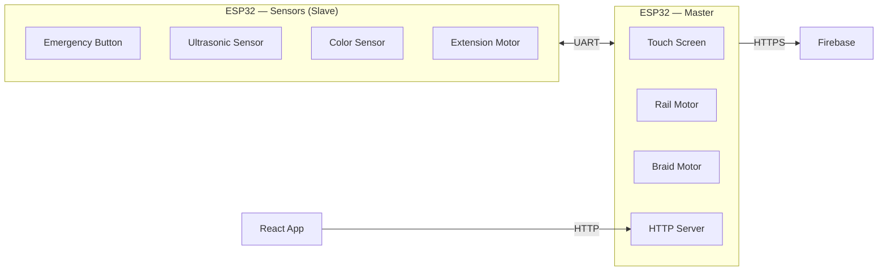

# 🪢 AutoBraid

AutoBraid is a physical, automated hair-braiding machine built around two ESP32 microcontrollers, a
touchscreen interface, custom motor-driven mechanics, and a React + Firebase web application.

---

## Demo

🎥 **[Demo video](https://drive.google.com/file/d/1u_yvwhhGyoFPkr-3GAMNtI0DH4gLbsko/view?usp=sharing)**

---

## Overview

A user registers and logs into the web app, generates a one-time access code, and enters it on the
machine's touchscreen. After selecting extension options and inserting their hair, the machine
checks positioning with a distance sensor, optionally scans hair color to match an extension,
dispenses the chosen extension, and runs the braiding mechanism — with a physical emergency-stop
button available throughout the process.

---

## Main Features

- Dual ESP32 system (a master controller and a sensor/slave controller)
- Touchscreen interface for the full user flow
- Ultrasonic and color sensors for positioning and hair-matching
- Stepper and DC motor control for the braiding, rail, and extension mechanisms
- UART communication between the two controllers
- React web interface for registration, login, and order history
- Firebase integration (authentication and data storage)
- Custom mechanical system, including 3D-printed components

---

## System Architecture



The master board drives the screen, the rail and braid motors, and communicates with Firebase
through its own HTTP server. The slave board handles the sensors, the emergency button, and the
extension motor, reporting back to the master over UART.

---

## Hardware

Key components include two ESP32 controllers, a touchscreen display, an ultrasonic distance
sensor, an RGB color sensor, and three stepper motors with their drivers.

Full parts list: [hardware/BOM.md](hardware/BOM.md)

---

## Software

- **First ESP32** — reads the emergency button and sensors, and drives the extension motor on
  request from the master.
- **Second ESP32** — runs the main session logic, the touchscreen UI, the rail and braid motors,
  and a small HTTP server used by the React app. Communicates with Firebase for authentication and
  order data.
- **React app** — a web interface (built with Vite) for registration, login, generating machine
  access codes, and viewing order history.
- **Firebase** — provides authentication and stores users, access codes, and order history.

---

## Project Structure

```
auto_braid_machine/
├── first_esp32/       sensor/slave controller firmware
├── second_esp32/       master controller firmware (UI, motors, Firebase, HTTP API)
├── react-app/           React web application
├── hardware/
│   └── BOM.md            bill of materials
└── README.md
```

---

## Future Improvements

- Additional safety mechanisms (watchdog, timeouts, hardware cutoff)
- Expanded mechanical documentation once CAD/STL files are finalized
- Additional automated testing

---

## Setup

### ESP32 boards (Arduino IDE)

1. Open `first_esp32/` and `second_esp32/` as separate sketches and flash each to its board.
2. Required libraries: `TFT9341Touch` (Avi Hayun) for the screen, and the Firebase Arduino Client
   Library (Mobizt) for Firebase.
3. On the second board, copy `second_esp32/Secrets.h.example` to `second_esp32/Secrets.h` (not in
   git) and fill in your WiFi and Firebase details. Without it, the board runs in a demo mode with
   no network required.

### React app

```bash
cd react-app
npm install
npm run dev
```
